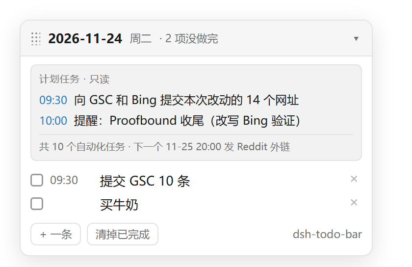

# dsh-todo-bar

**A todo bar that floats over the DeepSeek Harness interface.** Today's date, what is left, and the scheduled tasks the host already has queued — **all visible without opening anything.**

**Drag it anywhere. It remembers.** Double-click the title bar to send it back to the corner.

[npm](https://www.npmjs.com/package/dsh-todo-bar) · [Source](https://github.com/FindSomeSkills/dsh-todo-bar) · [中文说明](README.zh.md) · [完整说明](https://www.dshtoolbox.com/plugins/dsh-todo-bar/)

## What it looks like



Interface text follows the DSH language setting. Chinese DSH shows Chinese, English shows English.

## Install

```bash
dsh plugin --profile web add dsh-todo-bar
```

Or straight from the repository:

```bash
dsh plugin --profile web add github:FindSomeSkills/dsh-todo-bar
```

Restart the host once — the HTTP route and the client bundle both register at startup. If the bar does not appear afterwards, force-reload the page with `Ctrl+Shift+R`; the client bundle is cached hard.

## Adding an item

**There is no separate time field.** Put the clock time at the start of the line and it is pulled out:

| You type | Stored as |
|---|---|
| `09:30 提交 GSC 10 条` | time `09:30`, text `提交 GSC 10 条` |
| `9:30 买牛奶` | time `09:30` (normalized), text `买牛奶` |
| `8:00出去玩` | time `08:00`, text `出去玩` |
| `9：30培训` | time `09:30` (Chinese colon), text `培训` |
| `买牛奶` | no time, just text |
| `10:99 随便` | not a time — the whole line stays as text |

Single-digit hours are padded so sorting stays correct. **Impossible times (`10:99`, `25:00`) are rejected at both the interface and the storage layer** rather than silently corrupting the order.

Edit an item by clicking its text. If the text you save still starts with a time, it moves to the time column.

**Tick the box and the row disappears after 0.9 seconds.** Scheduled tasks leave the list the same way once they run — a list that keeps its finished rows turns into an archive nobody reads.

## Scheduled tasks

**The bar reads `$DSH_HOME/storages/schedule.json` directly** and lists only the tasks due **today**. A list of ten future tasks buries what you have to do now, so the footer carries the total and the next one instead:

```
共 10 个自动化任务 · 下一个 11-25 20:00 发 Reddit 外链
```

They are read-only. The scheduler owns them; the bar only tells you what today is already committed to.

## Crossing midnight

At local midnight, the whole of yesterday moves into an archive (last 30 days kept on disk), and only the unfinished items carry into the new day, tagged with the date they came from:

```
☐ 承接 11-23  发 dev.to                                  ×
```

Finished items do not follow you forward.

## Where the data lives

`$DSH_HOME/dsh-todo-bar/state.json`, default `~/.dsh/dsh-todo-bar/state.json`.

**One file, shared by every profile and every browser pointed at this host.** Writes go through a temporary file and a rename, so a crash mid-write cannot leave a half-written document. A damaged file is renamed to `state.json.corrupt-<timestamp>.bak` and replaced with an empty day — corruption never blocks the bar.

## The model can use it too

A `daily_brief` tool is registered against the same file the bar renders, so the two can never disagree:

| op | effect |
|---|---|
| `list` | read today's state |
| `add` | append an item (`text`, optional `due` and `session`) |
| `toggle` | flip done (`id`) |
| `edit` | rewrite text (`id`, `text`, optional `due`) |
| `remove` | delete (`id`) |
| `clearDone` | drop finished items |

Ask the agent to "add 'submit the sitemap' to today's list" and it lands on the bar you are looking at.

## HTTP routes

| Method | Path | Purpose |
|---|---|---|
| GET | `/dsh-todo-bar/state` | today's state, schedule summary; also triggers the midnight rollover |
| POST | `/dsh-todo-bar/mutate` | `{ op, text?, id?, due?, session? }` |

Bound to the host's listening address only. If the host route is unreachable — for example between install and the first restart — the client falls back to `localStorage` and says so at the bottom of the card.

## Requirements

- DeepSeek Harness `>= 0.2.0-rc.1` (needs the `shell.overlay` slot and `ctx.webServer`)
- A Web profile. CLI-only profiles have no web server, so the browser half has nothing to render into.
- **No platform code:** Windows, macOS and Linux run the same file.
- Desktop client is **untested**. The slot tree is probably the same, but "probably" is not "verified", so it is not claimed.

## What it is not

- No reminders. DSH already schedules work; a second reminder system would fight it.
- No categories, no Gantt charts, no time tracking, no Markdown view. Those exist in other plugins — this one is not trying to replace them.
- No history browser. The archive keeps 30 days on disk, but past days are not rendered: reading old lists is a different job from remembering today.
- Not a task graph for the model. It is a human's list, and the agent only reads or edits it when asked.

## Tests

```bash
node scripts/smoke.mjs          # 19 checks: storage, rollover, archive, corruption, routes, tool
node scripts/client-smoke.mjs   # 7 checks: bundle shape, slot registration, i18n parity, render path
node scripts/verify.mjs         # 12 end-to-end checks against the running host
```

Both suites run against a throwaway `DSH_HOME`, so they never touch your real list.

## License

MIT
