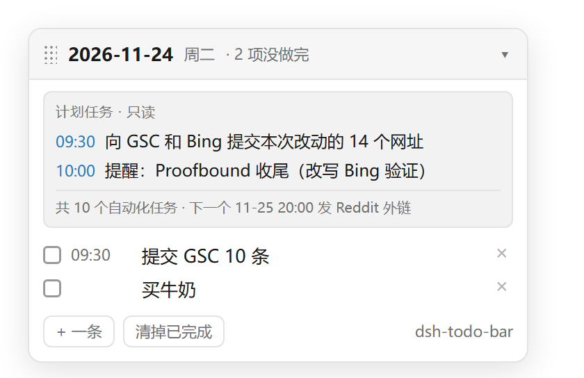

# dsh-todo-bar

**一条浮在 DeepSeek Harness 界面上的待办栏**：今天的日期、还剩几项、以及宿主里已经排好的自动化任务，**全都不用打开就能看见**。

**能拖到任何位置，位置记住。** 双击标题栏归位。挡事的时候收起来只剩一行。

[npm](https://www.npmjs.com/package/dsh-todo-bar) · [Source](https://github.com/FindSomeSkills/dsh-todo-bar) · [中文说明](README.zh.md) · [完整说明](https://www.dshtoolbox.com/zh/plugins/dsh-todo-bar/)

## 长什么样



界面文字跟随 DSH 的语言设置。DSH 是中文就显示中文，英文就显示英文。

## 装

```bash
dsh plugin --profile web add dsh-todo-bar
```

或者直接从仓库装：

```bash
dsh plugin --profile web add github:FindSomeSkills/dsh-todo-bar
```

装完**重启一次宿主**，HTTP 路由和客户端 bundle 都是启动时注册的。如果重启后没看到这条栏，按 `Ctrl+Shift+R` 强制刷新——客户端 bundle 缓存得很死。

### 一句话装好

把这段发给 DSH。**它会检查前置条件、装写死的版本、核对磁盘上的版本、重启宿主，再告诉你该看什么。** 需要能访问 `registry.npmjs.org`；不通就停下，不会去改别的配置。

```
帮我安装 DSH 插件 dsh-todo-bar 0.2.2，按顺序做，哪一步失败就停下把原文报给我：
1. 检查 node -v 是否 20 或更高，git --version 是否可用；
2. 执行 dsh plugin --profile web add dsh-todo-bar@0.2.2（版本必须写死，pnpm 会跳过刚发布的版本）；
3. 读 ~/.dsh/profiles/web/node_modules/dsh-todo-bar/package.json，确认 version 是 0.2.2；
4. 重启宿主：Windows 停掉 DSH021-Web 再启动；macOS 执行 launchctl kickstart -k gui/$(id -u)/com.deepseek.dsh.web；
5. 打开 http://127.0.0.1:2081 强刷页面，确认待办卡片出现在输入框上方。
需要能访问 registry.npmjs.org；失败就停下把原文给我。
```

## 加一条

**没有单独的时间输入框。** 把时间写在开头，它自己摘出来：

| 你输入 | 存成 |
|---|---|
| `09:30 提交 GSC 10 条` | 时间 `09:30`，正文「提交 GSC 10 条」 |
| `9:30 买牛奶` | 时间 `09:30`（自动补零），正文「买牛奶」 |
| `8:00出去玩` | 时间 `08:00`，正文「出去玩」 |
| `9：30培训` | 时间 `09:30`（中文冒号也认），正文「培训」 |
| `买牛奶` | 没时间，整条当正文 |
| `10:99 随便` | 不算时间，整条留在正文 |

一位数的小时会被补成两位，否则排序会错。**不存在的时间（`10:99`、`25:00`）在界面和存储两层都被挡住**，不会悄悄把顺序搞乱。

点文字可以改。如果改完开头还带着时间，它会自动挪到时间列。

**勾上复选框，0.9 秒后这一行自己消失。** 自动化任务跑完也是这个行为——留住已完成条目的清单，最后都会变成没人看的档案。

## 自动化任务

读 `$DSH_HOME/storages/schedule.json`，只列**今天到期**的。未来十条全摆出来会把今天真正要做的埋掉，所以底部那行写总数和下一个：

```
共 10 个自动化任务 · 下一个 11-25 20:00 发 Reddit 外链
```

**自动化任务和你自己的清单摆在同一张卡里**——别家没这么做。它们是只读的：归 DSH 的定时器管，这条栏只负责让你看见今天已经承诺了什么，**避免自己跟自己撞车**。

## 跨零点

本地零点一到，昨天整份进归档（磁盘上留最近 30 天），只有没做完的带进新的一天，标上它从哪天来的：

```
☐ 承接 11-23  发 dev.to                                  ×
```

做完的不会跟过来。

## 升级不会自动发生

**没有自动升级。** 安装时把精确版本写进 profile，DSH 也没有更新守护进程：你不敲命令，版本就不会变。**后台直接换文件更糟：** 插件跑在宿主进程里，运行中替换文件会让一半路由停在旧代码上。

把这段发给 DSH：

```
帮我升级 DSH 插件 dsh-todo-bar：
1. 读当前版本：cat ~/.dsh/profiles/web/node_modules/dsh-todo-bar/package.json | grep '"version"'
2. 查最新版本：npm view dsh-todo-bar version
3. 两者相同就告诉我「已是最新」，不要动任何文件；
4. 不同则执行 dsh plugin --profile web add dsh-todo-bar@<最新版本>（版本写死）；
5. 再读一次磁盘版本，确认已变；
6. 重启宿主：Windows 停掉 DSH021-Web 再启动；macOS 执行 launchctl kickstart -k gui/$(id -u)/com.deepseek.dsh.web；
7. 打开 http://127.0.0.1:2081 强刷页面，确认卡片还能打开。
需要能访问 registry.npmjs.org；失败就停下把原文给我。
```

## 数据在哪

`$DSH_HOME/dsh-todo-bar/state.json`，默认 `~/.dsh/dsh-todo-bar/state.json`。

**一个文件，所有 profile、所有连到这台机器的浏览器共用。**写入走临时文件 + rename，写到一半断电不会留下半个 JSON。文件坏了会改名成 `state.json.corrupt-<时间戳>.bak` 再重建空清单——损坏不会让这条栏打不开。

## 模型也能读写

注册了 `daily_brief` 工具，和界面用同一份文件，两边不可能对不上：

| 操作 | 作用 |
|---|---|
| `list` | 读今天的清单 |
| `add` | 加一条（`text`，可选 `due`、`session`） |
| `toggle` | 勾选 / 取消（`id`） |
| `edit` | 改文字（`id`、`text`，可选 `due`） |
| `remove` | 删一条（`id`） |
| `clearDone` | 清掉已完成的 |

跟 agent 说「把『提交 sitemap』加到今天待办」，它就落到你正在看的这条栏上。

## HTTP 路由

| 方法 | 路径 | 作用 |
|---|---|---|
| GET | `/dsh-todo-bar/state` | 今天的状态与任务汇总，顺带触发跨天归档 |
| POST | `/dsh-todo-bar/mutate` | `{ op, text?, id?, due?, session? }` |

只绑宿主自己的监听地址。如果宿主路由不通——比如装完还没重启——界面会退回浏览器本地存储，并在卡片底部写明。

## 运行要求

- DeepSeek Harness `>= 0.2.0-rc.1`（要 `shell.overlay` 插槽和 `ctx.webServer`）
- 必须是 Web profile。纯命令行的 profile 没有 web server，浏览器那一半无处可挂
- **没有平台相关代码**，Windows / macOS / Linux 跑同一份文件
- Desktop 客户端**没测过**。插槽树大概率一样，但「大概率」不等于验证过，所以不写支持

## 它不是什么

- 不做提醒。DSH 自己会排任务，再加一套只会打架
- 不做分类、不做甘特图、不做耗时统计、不做 Markdown 视图。那些别的插件都有，这个不打算替代它们
- 不做历史浏览。归档留 30 天，但界面不渲染过去的日期：翻旧账和记住今天是两件事
- 不是给模型的任务图。它是人的清单，模型只在被要求时读写

## 测试

```bash
node scripts/smoke.mjs          # 19 项：存储、跨天、归档、损坏恢复、路由、工具
node scripts/client-smoke.mjs   # 7 项：bundle 结构、插槽注册、中英字典对齐、渲染
node scripts/docs-check.mjs     # 6 项：随包发出的说明页与插件实际行为一致
node scripts/verify.mjs         # 13 项：对运行中的宿主做端到端验证
```

前三套跑在临时 `DSH_HOME` 里，不碰真实清单；最后一组会往运行中的宿主写两条探针条目，再删掉。

## 许可

MIT
