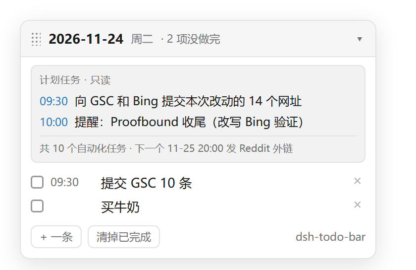

# dsh-todo-bar

**It is already on screen when you open a session.** No sidebar icon to click, no panel to remember to open.

**Drag the card anywhere and it returns to that spot after a reload.** Double-click the title bar to send it back to the bottom-right corner. The arrow on the left folds it into a single line when it covers something.

## What is in the card

Today's date and weekday, how many manual items are still open, and the items themselves, each with an optional clock time in front.

**Today's scheduled tasks sit in the same card as your own list** — read-only, because the scheduler owns them. The card only shows what today is already committed to, which is how you notice you have booked yourself twice.

The footer carries the total number of active scheduled tasks and when the next one fires. Ten future tasks in the list would bury what has to happen now.

## Adding an item

One line. A clock time at the start is pulled out into its own column:

| Typed | Stored as |
|---|---|
| `09:30 submit the sitemap` | time `09:30`, text `submit the sitemap` |
| `9:30 buy milk` | time `09:30` |
| `buy milk` | no time, just text |

A full-width colon works too. **Times that cannot exist — `10:99`, `25:00` — are not treated as times.** They stay in the text where you can see them instead of quietly breaking the sort order.

Click an item's text to edit it. **Tick the box and the row is gone 0.9 seconds later.**

## Midnight

At local midnight the whole of yesterday moves into an archive (30 days kept on disk). **Only unfinished items move into the new day**, tagged with the date they came from — `carried 11-23`.

## Where the data lives

`$DSH_HOME/dsh-todo-bar/state.json`, by default `~/.dsh/dsh-todo-bar/state.json`.

One file, shared by every profile and every browser pointed at this host. Writes go through a temporary file and a rename, so a crash mid-write cannot leave half a document. A damaged file is renamed to `state.json.corrupt-<timestamp>.bak` and replaced with an empty day.

The model reads and changes the same list through the `daily_brief` tool — `list`, `add`, `toggle`, `edit`, `remove`, `clearDone`. **The card and the tool agree because they open one file, not two.**

Two HTTP routes serve the browser half: `GET /dsh-todo-bar/state` and `POST /dsh-todo-bar/mutate`. Between install and the first host restart the route is not there yet; the card falls back to browser storage for that window and says so under the list.

## Requirements

- DeepSeek Harness `>= 0.2.0-rc.1`, because the card uses the `shell.overlay` slot and the host half needs a web server
- A Web profile. A command-line-only profile has no web server, so the browser half has nothing to render into
- Windows, macOS and Linux run the same code — there is no platform-specific branch
- The Desktop client is untested. The slot tree is probably the same, but "probably" is not verified, so it is not claimed

## What it does not do

**No reminders.** DSH already schedules work, and a second reminder system would fight it.

No categories, no time tracking, no Markdown view, no browser for past days. The archive keeps 30 days on disk; reading old lists is a different job from remembering today. Other plugins cover those, and this one is not trying to replace them.
