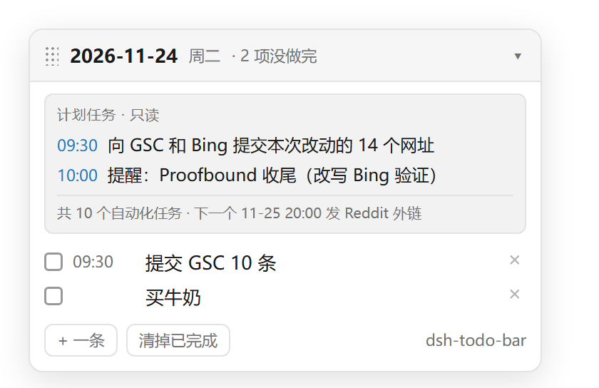

# dsh-todo-bar

**打开任何会话它就已经在屏幕上了。** 不用点侧栏图标，也不用记得去打开哪个面板。

**拖到哪儿，刷新以后还在那儿。** 双击标题栏回到右下角。挡着内容时点左侧的箭头，收成一行。

## 卡片里有什么

今天的日期和星期、手动待办还剩几项，以及这些待办本身——每行前面可以有时间，也可以没有。

**今天要跑的自动化任务和你自己的清单在同一张卡里**，只读，因为定时器归 DSH 管。卡片只负责让你看见今天已经承诺了什么，这样才不会自己跟自己撞车。

底部一行写清一共有几个自动化任务、下一个什么时候跑。把十个未来任务塞进列表，只会把今天必须做的事埋掉。

## 加一条

只用一个输入框。行首的时间会被拆到单独一列：

| 输入 | 存成 |
|---|---|
| `09:30 提交 sitemap` | 时间 `09:30`，文字「提交 sitemap」 |
| `9:30 买牛奶` | 时间 `09:30` |
| `买牛奶` | 无时间 |

全角冒号也认。**不存在的时间——`10:99`、`25:00`——不会被当成时间**，它留在文字里让你看见，而不是悄悄把排序搞乱。

点一下条目文字就能改。**勾上以后 0.9 秒这一行消失。**

## 跨天

本机零点，昨天整份进归档，盘上留 30 天。**只有没做完的会进新的一天**，行尾标着它来自哪天——「承接 11-23」。

## 数据在哪

`$DSH_HOME/dsh-todo-bar/state.json`，默认 `~/.dsh/dsh-todo-bar/state.json`。

一个文件，所有 profile、所有连到这台宿主的浏览器共用一份。写入走临时文件再改名，中途断电不会留下半个 JSON。文件坏了会改名成 `state.json.corrupt-<时间戳>.bak`，然后重建空清单。

模型通过 `daily_brief` 工具读写同一份清单——`list`、`add`、`toggle`、`edit`、`remove`、`clearDone`。**卡片和工具不会打架，因为它们打开的是同一个文件，不是两份。**

浏览器这一半走两条 HTTP 路由：`GET /dsh-todo-bar/state` 和 `POST /dsh-todo-bar/mutate`。装完到重启宿主之间路由还不存在，这段窗口里卡片退到浏览器存储，并在列表下面写明。

## 需要什么

- DeepSeek Harness `>= 0.2.0-rc.1`：卡片挂在 `shell.overlay` 槽位上，宿主这一半要用 web 服务
- Web profile。纯命令行的 profile 没有 web 服务，浏览器这一半没有地方可渲染
- Windows、macOS、Linux 跑的是同一份代码，没有平台分支
- 桌面客户端没验证过。槽位树大概一样，但「大概」不是「验证过」，所以不写成支持

## 它不做什么

**不做提醒。** DSH 本来就会排任务，再来一套提醒只会跟它打起来。

没有分类、没有计时、没有 Markdown 视图、没有历史浏览。归档在盘上留 30 天，但卡片不渲染过去的日子——翻旧清单和记住今天不是一件事。这些别的插件在做，它不打算替代。
